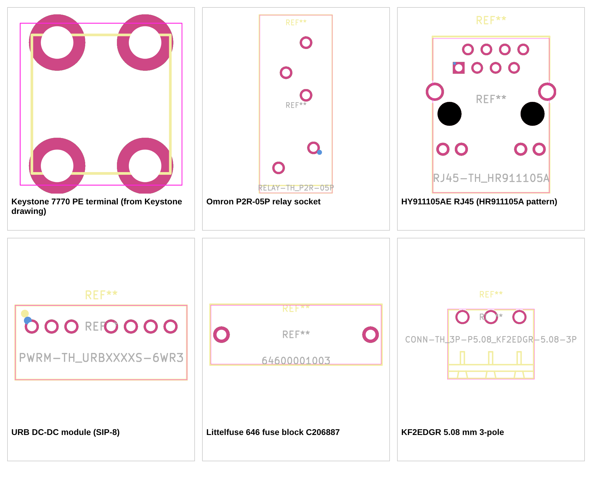

# M2 - Libraries for review

Project libraries are in `lib/` (`lcsc.kicad_sym`, `lcsc.pretty/`, `lcsc.3dshapes/`), wired into the KiCad project by `hardware/sym-lib-table` and `hardware/fp-lib-table`. Resistors, capacitors, LEDs, the ferrite bead and resistor arrays use KiCad's standard symbols and footprints with the LCSC field filled (every standard footprint named in the BOM was checked to exist).

## What is in the library

| | Count |
|---|---|
| Symbols | 44: 39 imported with easyeda2kicad and 5 made by `scripts/make_manual_parts.py` because EasyEDA has no data for them (the Keystone 7770 footprint is drawn from the Keystone drawing; the two cable plugs, the fuse-block cover and the PE screw are pin-less accessories cloned from a sibling plug) |
| Of which "not on the PCB" accessories (plugs, shunt, glass fuses, cover, screw) | 9, pin-less, excluded from the board but kept in the BOM |
| Footprints | 32 |
| 3D models | 30 (`.wrl` only; the 80 MB of `.step` files are ignored by git and regenerated by `scripts/import_lcsc.py`) |

## Decisions from the review (2026-11-06), all applied and logged in `docs/plan.md`

| Question | Decision | What changed |
|---|---|---|
| LAN9252 has no ERR LED output | Use a spare STM32 pin and move to a 100-pin package so pins never run short | MCU is now the **STM32F405VGT6 (LQFP-100, C56621, 82 I/O, 920 in stock at lcsc.com)**. Every existing pin assignment is unchanged. ERR LED on **PD3**. PH1 stays a test pad; 30 pins are free. Six VDD pins need six 100 nF capacitors. About $7.6 each. |
| PE terminal ships without its screw | Keep the Keystone 7770 and add a screw | M3 x 6 pan-head screw **C357543** (34,500 in stock) added as an accessory. Length 6 mm to be confirmed against the ring lug at the mechanical review. |
| LCSC stock showed 0 on four capacitors | PCBPower buys from lcsc.com only; JLCPCB is not used for sourcing | lcsc.com stock is now the only stock that counts. Replaced: 100 nF **C1591** (1.4M), 10 nF **C1589** (1.9M), 1 uF 0603 **C559769** (X7R, 611k), 1 uF 0805 **C91185** (160k). The JLCPCB stock lookup was removed from the BOM builder; the rule is now in `CLAUDE.md`. |
| Footprints without a dimensioned drawing | Replace with parts that have drawings | Only the fuse holder lacked one (see below). The RJ45 and Keystone do have drawings, and the footprints now check out against them. |

### Footprint verification result

- **Fuse holder C58066: replaced** by the **Littelfuse 646 fuse block (C206887) with the 648 clear polycarbonate cover (C187509)**. The old holder's datasheet had no dimensions and a hidden 80 C limit. The Littelfuse datasheet has the full drawing; the footprint's pads are exactly 22.6 mm apart with 1.5 mm holes, as its "Recommended Hole Pattern" says. 250 V, 6.3 A (5 A at 1 W with the cover). Same block and cover for the two 24 V inputs. **Note:** the Littelfuse datasheet states no operating temperature.
- **RJ45 HY911105AE: kept.** Its datasheet does have a full mounting-pattern drawing. At higher zoom the dimension I could not place earlier turns out to be the outline-to-post distance, not the LED-to-signal-row distance. Every printed dimension now matches the footprint: LED span 13.25 mm, post spacing 11.43 mm, shield posts 15.49 mm, LED row to post line 4.90 mm, post line to even pin row 8.89 mm, pin pitch 2.54 mm.
- **Keystone 7770: kept.** The Keystone drawing gives 5.00 x 7.01 mm and 1.85 mm holes; the pad bounding box is exactly that.
- Also measured against their datasheet drawings: **P2R-05P relay socket** (6, 4.5, 15, 4, 4 and 7 mm) and **URB modules** (2.54 mm pitch, pin 4 absent, 17.78 mm span).

These are now automatic checks in `scripts/pincheck.py`, so they re-run whenever the library changes.

## Checks run

| Check | Result |
|---|---|
| Every symbol pin name and number against the manufacturer datasheet (each table names its source) | **44 of 44 clean** ([pin-by-pin tables](M2-pin-check.md)), including all 100 STM32F405VGT6 pins |
| Footprint geometry against the printed dimensions on the datasheet drawings (RJ45, relay socket, URB modules, fuse block, Keystone, KF2EDGR connectors, header) | all within 0.15 mm |
| Every symbol pin number has a footprint pad and vice versa | clean |
| Value, Footprint, LCSC, MPN, Manufacturer, Datasheet on every symbol | clean |
| No pin left as `unspecified` (needed for ERC to mean anything) | clean |
| KiCad 10 loads the symbol library (`kicad-cli sym upgrade`) and all 32 footprints (`kicad-cli fp export svg`) | clean |
| Diode and electrolytic polarity against footprint silkscreen | clean |
| Every BOM LCSC number exists on lcsc.com and has stock for one board | clean (only note: relay socket P2R-05P has 44 in stock, 8 per board) |

## What was wrong in the EasyEDA import

Full list in [M2-symbol-fixes.md](M2-symbol-fixes.md). The ones that would have caused real errors:

- **LAN9252** pin 5 was named `VDD3`; the datasheet name is `VDD33`.
- **PSM712 TVS** pins were `A1, A1, K`; the datasheet has two line pins and a common pin 3 (`IO1, IO2, COM`).
- **RJ45, relay socket, TLP290-4, SMBJ33A, both electrolytic capacitors** had unnamed pins. Now named from the datasheets (RJ45 centre taps and LED pairs, relay coil/COM/NO/NC, optocoupler channel pairs, diode cathode/anode, capacitor polarity).
- Every pin was `unspecified`; all now have power, input, output, open-collector, bidirectional or passive types.
- Manufacturer names were Chinese and Datasheet fields pointed to web pages. Now English names and direct PDF links.
- Cable plugs, the jumper shunt and the glass fuses had placeholder footprints, one of which KiCad could not load. They are now pin-less "exclude from board" symbols.
- 3D model paths pointed at `${KIPRJMOD}/lib/`; the KiCad project is in `hardware/`, so they are now `${KIPRJMOD}/../lib/`.

Everything else matched the datasheets as imported.

## Datasheet findings the schematic must respect

- **Relay G2R-1-S (socket P2R-05P):** coil on terminals 1 and 5, **COM = 2, NO = 3, NC = 4** (the arm rests on 4 de-energised). Coil 1113 ohm, 21.6 mA at 24 V; ambient -40 to +70 C.
- **STM32F405VGT6 (LQFP-100):** VDD on pins 11, 19, 28, 50, 75, 100 (six 100 nF), VSS on 10, 27, 74, 99, VCAP_1 on 49 and VCAP_2 on 73 (2.2 uF each), VDDA 22 with VREF+ 21, BOOT0 94, VBAT 6.
- **CA-IS3742LN:** the two reverse channels are VO3 and VO4 on the logic side (pins 5, 6); the relay OE forward channel is VI1/VO1. The CA-IS3740 has an `ENB` pin (10) on the field side, as the plan's OE scheme needs.
- **URB modules:** pin 1 input GND, 2 Vin, 3 **Ctrl** (remote on/off; open or high = on, so leave it open), 5 and 8 NC (no pin 4), 6 +Vo, 7 output 0 V. Maximum input 40 V.
- **Oscillator:** pin 1 is output enable (not connected or high = running), 2 GND, 3 output, 4 VDD.
- **AM26LS32:** `A` is the non-inverting input and `B` the inverting one. The enables are one common pair with a choice of polarity: tie pin 4 `G` high **or** pin 12 `/G` low (one is enough) or all four receivers stay in high impedance.
- **RJ45 HY911105AE:** green LED pins 9 (anode) and 10 (cathode), yellow 12 (anode) and 11 (cathode); P4 and P5 are the TX and RX centre taps; the four 75 ohm cable-side terminations return to P8 (chassis GND) through an internal 1000 pF/2 kV capacitor, and the datasheet says to connect P8 to PCB/chassis ground, so P8 goes to PE in the schematic (the shell tabs SH1/SH2 are separate and use the plan's 1 nF/2 kV + 1 Mohm network to PE).

## Notes (no decision needed)

- The Littelfuse 646 datasheet states no operating temperature (the open 649 block states -30 to +85 C). Housing is PA 6.6, UL 94 V-0. Ask Littelfuse if the enclosure limit (80 C) matters.
- The G2R-1-S relay is rated to +70 C ambient, 10 C below the 80 C enclosure reference; the plan already accepts that.
- The standard IC package footprints from EasyEDA (QFP, SOIC, SOT, SOP) were checked for pin count and numbering, not measured against package drawings.
- STM32F405VGT6 costs about $7.6 (the plan assumed about $3.2 for the 64-pin part).



## How to regenerate

```
python3 -I scripts/import_lcsc.py          # EasyEDA import (retries; the API returns 403 intermittently)
python3 -I scripts/make_manual_parts.py    # parts EasyEDA lacks (404)
python3 -I scripts/fix_symbols.py          # names, types, fields; --lib/--log to log from lib/raw/
python3 -I scripts/pincheck.py --md docs/review/M2-pin-check.md
python3 -I scripts/build_bom.py            # BOM, with library footprints, stock from lcsc.com only
```
