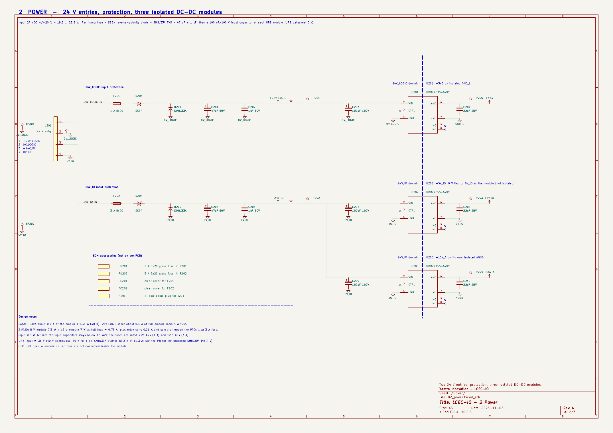
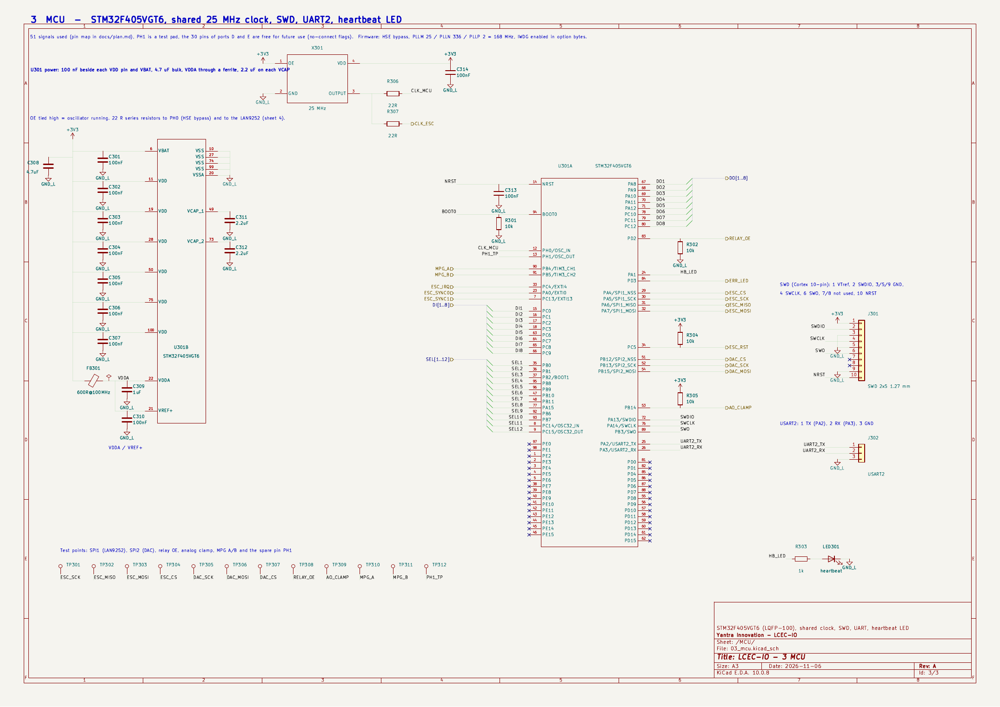

# M3 - Power and MCU sheets for review

KiCad project: `hardware/lcec-io.kicad_pro`. Sheets: root `lcec-io.kicad_sch` (page 1), `02_power.kicad_sch` (page 2), `03_mcu.kicad_sch` (page 3). Everything is generated by `scripts/build_schematics.py` (deterministic: re-running gives identical files) and checked from KiCad's own netlist by `scripts/check_sheets.py`.

**To review in the browser:** [`M3-schematics.pdf`](M3-schematics.pdf) (all three sheets, A3), or the previews below. ERC report: [`M3-erc.rpt`](M3-erc.rpt).

## Redrawn after review: drawing rules

The first M3 submission was rejected for unprofessional layout (rotated parts, sideways text, cluttered placement). Both sheets were redrawn from scratch under these rules, and `scripts/check_sheets.py` now enforces them (check `style`):

- **Every component instance is at rotation 0 and never mirrored; all text and labels are horizontal.** Where a circuit needs a part drawn the other way (series fuse, diode, resistor or ferrite on a horizontal rail; shunt TVS or capacitor), the standard KiCad graphics were rotated once in the library instead (`scripts/make_std_symbols.py` -> `lib/lcec.kicad_sym`), so they look standard.
- No symbol pin sits on the top or bottom edge (KiCad prints those names sideways). The STM32 is a two-unit symbol: signals (U301A, left and right pins in functional groups) and power (U301B). URB modules and the oscillator have inputs left, outputs right.
- Parts are aligned in rows and columns, decoupling capacitors sit beside the pin they serve, every net runs directly or ends in a short stub with a label, and notes and captions are kept clear of pins and the page frame.

## Definition of done

| Requirement (`CLAUDE.md`) | Result |
|---|---|
| `kicad-cli sch erc` reports zero errors, run from the root so the whole hierarchy is checked | **0 errors**, 2 warnings (explained below) |
| STM32 nets match the pin map table in `docs/plan.md`, checked by script | **all 52 signals match**; the script parses the table out of `docs/plan.md` itself, compares it with `scripts/pinmap.py`, then compares every STM32 pin's net in the netlist. Proven able to fail: swapping two pins is caught at both stages. The 30 free pins are unconnected with no-connect flags. |
| PDF exported, rendered to PNG, visually checked for overlaps, off-grid wires, labels crossing the barrier | PDF and PNGs below. Overlaps found in the first renders (rotated text, collisions, content under the title block) were fixed and re-rendered. No off-grid endpoints (ERC), no four-way junctions (rule enabled as an error in the project), and no wire crosses the isolation barrier (checked by script). |
| Every symbol has Value, Footprint, LCSC, MPN, Manufacturer, Datasheet | all 47 parts, checked by script; every LCSC number is in `bom/parts.csv` and no BOM quantity is exceeded |
| A3 landscape, title block filled, 50 mil grid, separate power symbols per domain, hierarchical labels between sheets, designators numbered by sheet | yes (R3xx on sheet 3, C2xx on sheet 2 and so on). Buses `DI[1..8]`, `SEL[1..12]`, `DO[1..8]`. Global labels only for power. |

### ERC warnings (2), explained

Both are `ground_pin_not_ground` on the URB modules' input-side pin named `GND` (U201 on `0V_LOGIC`, U203 on `0V_IO`). KiCad only accepts net names containing "GND" as grounds; the plan fixes the field and logic return nets as `0V_IO` and `0V_LOGIC`. The connections are correct (verified from the netlist). Not fixed because renaming either the datasheet pin or the plan's net names would be worse than a warning.

### Root sheet placeholders

The MCU sheet's 25 hierarchical pins (to EtherCAT, inputs, MPG, relays and analog sheets) carry **no-connect flags on the root sheet**, so ERC is clean today. They are replaced by wires in M4 and M5 as those sheets are added. The full root sheet (block diagram, mounting holes, PE) is M6.

## Sheet 2 - Power



- **Chain per input (as in the plan):** fuse (F201 1 A, F202 3 A) > SS54 series diode > SMBJ33A TVS > 47 uF + 1 uF > 100 uF/100 V at each module. The TVS cathode is on the rail, the diode anode toward the input (both verified from the netlist).
- **Modules:** U201 URB2403S (+3V3, GND_L), U202 URB2405S (+5V_IO, 0 V tied to 0V_IO at the module), U203 URB2415S (+15V_A, AGND). CTRL left open (= on, datasheet) and the two NC pins flagged. Output capacitor 22 uF/25 V each. The dashed isolation barrier runs through the modules; the 24V_LOGIC and +3V3/GND_L domains, and AGND and 0V_IO, share no net.
- **Test points** on every rail and ground (TP201 to TP207).
- **BOM accessories** (glass fuses, fuse covers, cable plug) are pin-less "not on the PCB" symbols so they appear in the BOM.

### Numbers checked

| Item | Value |
|---|---|
| Logic input, full module load | about 0.3 A (4.5 W / 78 % at 19.2 V): 1 A fuse, 30 % |
| I/O input, worst case | 5 V module 7.3 W + 15 V module 7 W (0.75 A) + relay coils 0.21 A at 28.8 V + sensors through the two 0.5 A PTCs (1 A) = about 2.0 A against 3 A (about 2.4 A after a 0.8 derating at 80 C): 18 % margin |
| Inrush into the input capacitors, worst case | 24V_LOGIC 148 uF, 24V_IO 248 uF. Through 0.2 ohm of source and cable the charging I2t is 0.31 and 0.51 A2s; through 0.1 ohm, 0.61 and 1.03 A2s |
| 1 A fuse I2t (datasheet 5F series) | 4.26 A2s: about 7x margin over the 0.61 A2s worst inrush at 0.1 ohm, no nuisance blowing |
| 3 A fuse melting I2t (LCSC data, 5G series) | 12.5 A2s: more than 12x margin |

## Open question for you: TVS against the URB surge rating

You asked me to keep the SMBJ33A and design module-side limiting in M3. This is what I found in the URB datasheet, and what I propose. **The sheet is built with the approved SMBJ33A; nothing is changed until you decide.**

| | URB2403/05/15S rating | SMBJ33A (C320242, as built) | SMBJ30A (proposal) |
|---|---|---|---|
| Continuous input maximum | 40 V | stand-off 33 V | stand-off **30 V** (above 28.8 V maximum input) |
| Surge | **50 V for 1 s** (24 V series) | clamp **53.3 V** at 11.3 A (above the rating at its rated pulse) | clamp **48.4 V** at 12.4 A (below the rating) |

Datasheet context: the URB's own EMC circuit uses a fuse and a 330 uF/50 V bulk capacitor and no TVS, and the surge test is line to line +/-2 kV with that circuit. Neither TVS keeps the rail under the 40 V continuous maximum during a surge pulse; the datasheet only gives a 50 V figure for 1 s.

**Proposal:** replace D201 and D202 with the SMBJ30A **Littelfuse C83851** (17,085 in stock on lcsc.com, same SMB package, 1 uA leakage at stand-off, about $0.06 more per diode). No other parts change. If you prefer to keep the SMBJ33A, say so and I record that as the decision.

## Sheet 3 - MCU



- **STM32F405VGT6 (LQFP-100)** laid out functionally: supplies on top and bottom, signals in groups on the sides, buses to the sheet edge, the 30 free pins of ports D and E at the bottom with no-connect flags. A 100 nF capacitor sits beside each of the 6 VDD pins and VBAT; 4.7 uF bulk; VDDA and VREF+ from the ferrite (FB301) with 1 uF + 100 nF; 2.2 uF on each VCAP.
- **Clock:** 25 MHz oscillator X301 (OE tied high = running) to PH0 and to the LAN9252 (hierarchical label `CLK_ESC`), each through 22 ohm.
- **Debug and boot:** SWD header J301 (Cortex 10-pin), USART2 header J302, BOOT0 10 k to ground, NRST 100 nF.
- **Fail-safe:** 10 k pull-down on PD2 (relay OE), pull-ups on PB14 (AO_CLAMP) and PC5 (LAN9252 RST#). Heartbeat LED on PA1.
- **ERR LED:** PD3 leaves the sheet as `ERR_LED` (the LED and resistor go on the EtherCAT sheet in M4, with the RUN LED).
- **Test points** (TP301 to TP312): SPI1 and SPI2 signals, relay OE, analog clamp, MPG A/B and the spare PH1 pad.

## Library changes made in M3 (all re-run by the library scripts)

- New project library `lib/lcec.kicad_sym` (registered as `lcec`): rotated/mirrored copies of KiCad's standard fuse, resistor, ferrite, LED, Schottky and Zener graphics, single-row connectors with pins on the right, and the pin-less BOM accessory symbol. Pin numbers match the LCSC footprints.
- **STM32F405VGT6** and the three **URB** symbols were re-laid out for readability (`scripts/relayout_symbols.py`): pin numbers, names and types are unchanged apart from a short alternate function after the port name, so the datasheet check (44 of 44 symbols clean, re-run) still passes.
- STM32 `VCAP_1`/`VCAP_2` pins are now passive (they are the internal regulator's output; as power inputs they raised false "not driven" errors).
- `lib/lcsc.kicad_sym` is now committed in **native KiCad 10 format** (`scripts/finalize_lib.py`), so the library KiCad loads is exactly what the schematics embed.
- Project library tables in `hardware/` now list KiCad's standard symbol and footprint libraries too.

## How it was built and checked

```
python3 -I scripts/build_schematics.py   # writes hardware/*.kicad_sch (native KiCad 10 format)
python3 -I scripts/check_sheets.py       # ERC, pin map vs docs/plan.md, netlist checks, fields, barrier, BOM quantities
```

`scripts/schgen.py` reads pin positions from the symbol libraries (verified against KiCad's netlist at all four rotations), snaps everything to the 1.27 mm grid, adds junctions automatically and derives UUIDs from names.
