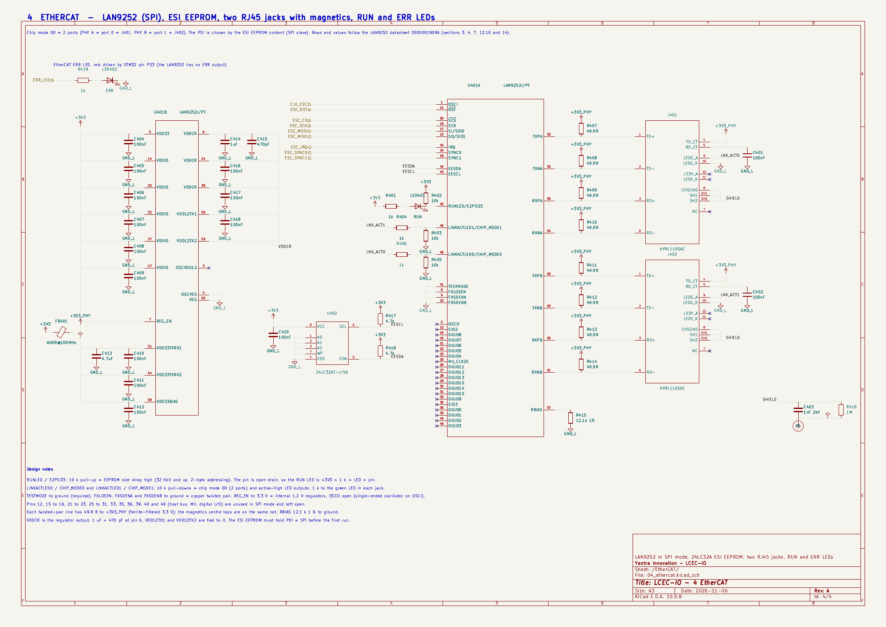

# M4 - EtherCAT sheet for review

KiCad project: `hardware/lcec-io.kicad_pro`. New sheet `04_ethercat.kicad_sch` (page 4). The root sheet now wires the ten MCU/EtherCAT nets between sheets 3 and 4. Generated by `scripts/build_schematics.py`, checked from KiCad's own netlist by `scripts/check_sheets.py`.

**To review in the browser:** [`M4-schematics.pdf`](M4-schematics.pdf) (all four sheets, A3), [`M4-sheet4-ethercat.png`](M4-sheet4-ethercat.png), [`M4-sheet1-root.png`](M4-sheet1-root.png). ERC report: [`M4-erc.rpt`](M4-erc.rpt). Sheets 2 and 3 are unchanged from M3 (`M3-sheet2-power.png`, `M3-sheet3-mcu.png`).



## Please read first: the reference schematic could not be fetched

The plan says "copied from the EVB-LAN9252-SPI reference schematic". Microchip's download host is blocked from this session, so I could not read that schematic. I drew the sheet from the **LAN9252 datasheet DS00001909A** (pin tables, power connections section 4, straps section 7, LEDs section 12.10, chip mode section 14) and the **HY911105AE datasheet** (the internal schematic of the jack). Items the datasheet does not give a value for are listed below as "my choice". If you can put the EVB-LAN9252-SPI schematic PDF into the repo, I will compare them line by line.

## Definition of done

| Requirement | Result |
|---|---|
| `kicad-cli sch erc` zero errors, run from the root | **0 errors**, the same 2 warnings as M3 (`ground_pin_not_ground` on U201/U203) |
| LAN9252 matches the reference circuit | drawn from the datasheet (see above); every item checked by script against the netlist |
| SPI/IRQ/SYNC/RST nets match the pin map in `docs/plan.md` | checked from the netlist: STM32 PA4/PA5/PA6/PA7/PC4/PA0/PC13/PC5 are on the same nets as LAN9252 pins 50/19/13/17/44/34/18/11 |
| Drawing rules from M3 | style check passes on all four sheets: every instance at rotation 0, none mirrored, all text horizontal, no pin on the top or bottom edge |
| Every symbol has Value, Footprint, LCSC, MPN, Manufacturer, Datasheet | all parts, checked by script; BOM quantities not exceeded |

## What is on the sheet

- **U401 LAN9252I/PT**, two units: signals (U401A) and power (U401B). Host interface is **SPI** (SCS#, SCK, SI, SO); IRQ, SYNC0, SYNC1, RST# go to the STM32; OSCI takes the 25 MHz clock from the MCU sheet (OSCO open, as the datasheet says for a single-ended oscillator).
- **Chip mode 00 (2 ports):** CHIP_MODE0/1 share the link LED pins and are held low by 10 k pull-downs. PHY A is port 0 (J401), PHY B is port 1 (J402).
- **EEPROM:** U402 24LC32A on EESDA/EESCL with 4.7 k pull-ups, WP low so the master can write the ESI. **E2PSIZE** (RUNLED pin) has a 10 k pull-up: strap high = 32 Kbit and up, 2-byte addressing, as the 24LC32A needs. The EEPROM image must set PDI = SPI.
- **Straps:** TESTMODE to ground (datasheet: must be VSS); FXLOSEN, FXSDENA, FXSDENB to ground = copper; REG_EN to 3.3 V = internal 1.2 V regulators.
- **Supplies:** 100 nF at VDD33 and each of the 5 VDDIO pins; VDDCR (3 pins) 1 uF + 470 pF at pin 6 and 100 nF on the others; VDD12TX1 and VDD12TX2 tied to VDDCR (datasheet: they must be tied together and are fed from the regulator via the PCB). OSCVDD12 left open (datasheet: no external capacitor required).
- **PHY 3.3 V** (VDD33TXRX1/2, VDD33BIAS): from +3V3 through ferrite bead FB401 (600 R at 100 MHz) with 4.7 uF + 100 nF each, net `+3V3_PHY`.
- **Twisted pairs:** TXP/TXN/RXP/RXN of each port go straight to the jack; each line has 49.9 R to `+3V3_PHY` (8 resistors). RBIAS 12.1 k 1 % to ground.
- **Jacks:** the HY911105AE has its own Bob Smith termination (4 x 75 R and 1 nF/2 kV to chassis, from its datasheet drawing). Both centre taps go to `+3V3_PHY` with 100 nF. Green LED = link/activity from the LAN9252 pin through 1 k (active high, because the strap is low). Yellow LED unused. CHS GND and both shield tabs go to the shield net: **1 nF/2 kV in parallel with 1 M to PE** (plan).
- **RUN LED:** +3V3 > 1 k > LED401 > RUNLED pin (open drain, active low because E2PSIZE is high). **ERR LED:** LED402 red, driven from the STM32 (PD3 via the `ERR_LED` hierarchical label) through 1 k.
- **Unused pins** (host bus, MII, digital I/O, OSCO, 20 pins) carry no-connect flags.

## My choices that the datasheet does not fix (please confirm)

1. 49.9 R from each of the four lines per port to `+3V3_PHY`, and both centre taps of each jack on `+3V3_PHY`. Reason: the datasheet says HP Auto-MDIX can swap the TX and RX pairs inside the chip, so both pairs need the 3.3 V supply. This is the usual 10/100 PHY arrangement.
2. 1 k for the link LEDs and the RUN/ERR LEDs (same part as the heartbeat LED, about 1 mA).
3. 10 k for the strap resistors (the internal pull is 50 uA typical, so 10 k gives about 0.5 V against the 0.8 V maximum low level).
4. The ferrite (600 R, same part as FB301) and 4.7 uF bulk on the PHY supply.

## BOM changes (this milestone)

- 49.9 R is now a fixed quantity of 8 (was an estimate).
- Added 470 pF 50 V X7R 0603, **C1620**, 77,200 in stock on lcsc.com; ferrite row now covers FB301 and FB401 (qty 2).
- LED references: RUN is LED401, ERR is LED402 (the plan list had LED401-LED402 and LED403).
- Removed the "10 uF x 4 (per LAN9252 reference in M4)" estimate row: the datasheet needs no 10 uF capacitor on this sheet.
- Still open from M3: Omron P2R-05P relay socket (C1524860) shows low stock, 44 on lcsc.com for 8 needed.

## Library changes

- `scripts/relayout_symbols.py` re-lays out the LAN9252 (two units, SPI signals grouped, blank rows where parts hang), the HY911105AE jack, and the 24LC32A EEPROM so no pin is on the top or bottom edge. Pin numbers are unchanged; the LAN9252 shows only the SPI-mode name of each pin, and `scripts/pin_tables.py` now compares by token for it. Datasheet pin check: 44 of 44 symbols clean.

## How it was built and checked

```
python3 -I scripts/relayout_symbols.py   # after fix_symbols.py; then finalize_lib.py
python3 -I scripts/build_schematics.py   # writes hardware/*.kicad_sch
python3 -I scripts/check_sheets.py       # ERC, pin map, netlist checks for sheets 2-4, style, fields, BOM quantities
```
