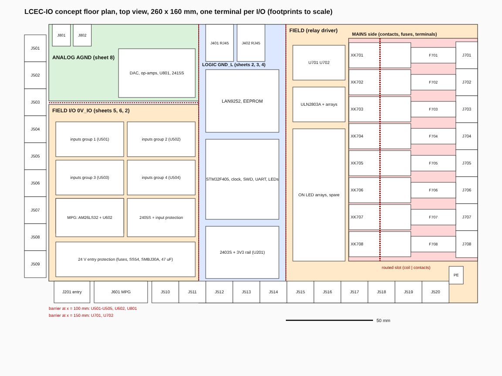

# M6 - Full review: root sheet, BOM export, PDF set, floor plan

Gate for layout: please read the **three decisions at the end** (board size, layers, enclosure) before layout starts. Everything is regenerated by scripts and checked from KiCad's own netlist.

**Browser files:** [`M6-schematics.pdf`](M6-schematics.pdf) (complete set, 13 pages A3), [`M6-sheet1-root.png`](M6-sheet1-root.png), [`M6-floorplan.png`](M6-floorplan.png), [`M6-bom.csv`](M6-bom.csv) (every line), [`M6-bom-assembly.csv`](M6-bom-assembly.csv) (what PCBPower assembles), [`M6-erc.rpt`](M6-erc.rpt). The per-sheet previews of sheets 2 to 8 are the M3, M4 and M5 PNGs in this folder; they are unchanged.

## What was added

- **Root sheet:** all seven sheets, the PE screw terminal J101 (Keystone 7770 plus its M3 x 6 screw as an accessory part), four M3 mounting holes (H101 to H104, 3.2 mm, not connected) and a block diagram of the four isolation domains with the parts that straddle each barrier. All hierarchical pins are wired; there are no placeholder no-connect flags left.
- **Checks added to `scripts/check_sheets.py`:** isolation (no component touches two domains except the 12 barrier parts, the two RJ45 jacks and the 24 V entry connector; no global labels anywhere), and BOM completeness (KiCad's own BOM export, every sheet instance, equals `bom/parts.csv` for all 75 LCSC numbers: 323 pieces).
- **`scripts/export_bom.py`** writes the BOM files. **`scripts/floorplan.py`** draws the floor plan from the real footprint courtyards.

## Result

| Check | Result |
|---|---|
| `kicad-cli sch erc` from the root | **0 errors**, 8 warnings, all `ground_pin_not_ground` on pins named GND/GNDB that sit on `0V_IO` or `0V_LOGIC` (the plan fixes these net names; connections verified from the netlist) |
| STM32 nets vs `docs/plan.md` | all 52 signals match |
| Drawing rules | 511 component instances: rotation 0, none mirrored, all text and labels horizontal |
| Datasheet pin and footprint check | 44 of 44 symbols clean |
| Every symbol has Value, Footprint, LCSC, MPN, Manufacturer, Datasheet | yes (292 parts); unfitted footprint-only parts excepted |
| BOM | 131 lines: 274 pieces fitted, 47 accessories not on the PCB, 16 bought locally in India (8 relays, 8 T5A fuses), 18 not fitted (8 snubber pairs, 2 x 120 R) |
| Isolation | verified by script, see above |

## Review against `docs/plan.md`

Each plan section was compared with the finished design. Everything matches, with these recorded changes (all in the plan's Decisions log):

| Plan said | Built | Why |
|---|---|---|
| STM32F405RGT6, 64 pins | F405VGT6, 100 pins | owner decision 2026-11-06 |
| SMBJ33A TVS | SMBJ30A | owner decision, below the URB 50 V surge rating |
| 9 grouped terminals | one 3-pole terminal per input and per relay, 2-pole per analog output | owner decision 2026-11-05 |
| EtherCAT sheet "copied from the EVB" | follows the EVB-LAN9252-SPI you supplied, with listed deviations (oscillator instead of crystal, 24LC32A, shield network) | M4 review |
| 5x20 fuse holder C58066 | Littelfuse 646 block C206887 with cover | M2 review |
| PTC per input terminal (plan text) | one 0.5 A PTC per group (DI, SEL) | M1 decision, same as the load budget on the power sheet (two PTCs) |
| 200 x 100 mm floor plan | 260 x 160 mm proposed | see next section |

No plan item is missing from the schematics. Test points: rails and grounds (TP201 to TP207), MCU signals (TP301 to TP312).

## Floor plan, redrawn with real footprints



The plan's 200 x 100 mm concept was drawn before the decision to use **one terminal per I/O**. With real footprints:

- Terminals need **506 mm of edge**: 28 three-pole terminals (20 inputs, 8 relays) at 15.5 mm each, the 6-pole MPG (30.7 mm), the 4-pole entry (20.6 mm) and two 2-pole analog outputs. A 200 x 100 mm board has 600 mm of perimeter, and the jacks, DIN-rail clips and corners take much of it, so it does not fit.
- The P2R-05P sockets are **35.5 mm long** (14.5 mm wide). Placed in one column of eight, each next to its 25.8 mm fuse block and its 12.5 mm terminal, they form a strip **74 mm deep and 124 mm tall** along the right edge, with the routed slot between coil and contact pins.
- Proposal: **260 x 160 mm**. Left edge nine input terminals, bottom edge the 24 V entry, the MPG and eleven input terminals, right edge the eight relay terminals, top edge the two RJ45 jacks and the two analog terminals. The three barriers are straight lines: x = 100 mm (optocouplers, MPG and analog isolators), x = 150 mm (relay isolators) and the routed slot at the relays. Component footprints cover about 43 % of the board, which is workable on four layers.

## Decisions needed from you before layout

1. **Board size.** 260 x 160 mm as proposed, or another size or shape if your enclosure sets one. If you need a narrower board, the options are two-row (stacked) terminals or fewer terminal positions, both of which change the one-terminal-per-I/O decision.
2. **Layer count.** The plan recommends four layers for the STM32 and LAN9252; I agree.
3. **Enclosure and DIN-rail housing** (inner width and height, mounting-hole pattern). The four M3 holes on the root sheet are placeholders at the corners.

## Regenerate

```
python3 -I scripts/build_schematics.py     # hardware/*.kicad_sch
python3 -I scripts/check_sheets.py         # ERC, pin map, netlist, style, isolation, BOM completeness
python3 -I scripts/export_bom.py           # docs/review/M6-bom*.csv
python3 -I scripts/floorplan.py            # docs/review/M6-floorplan.svg (PNG: render the SVG)
```
